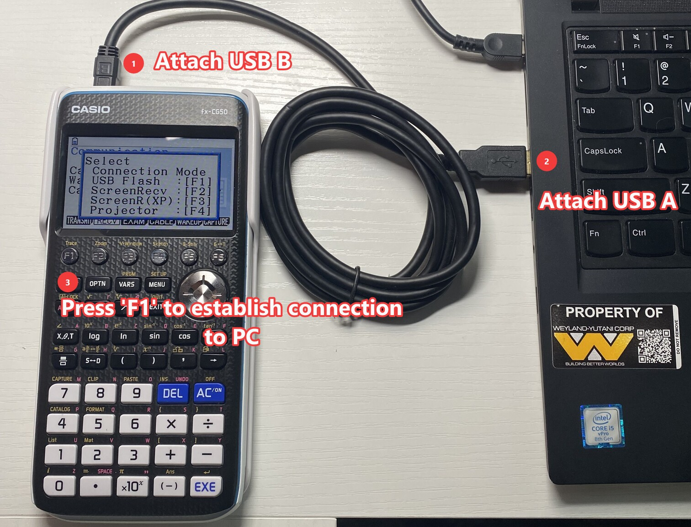
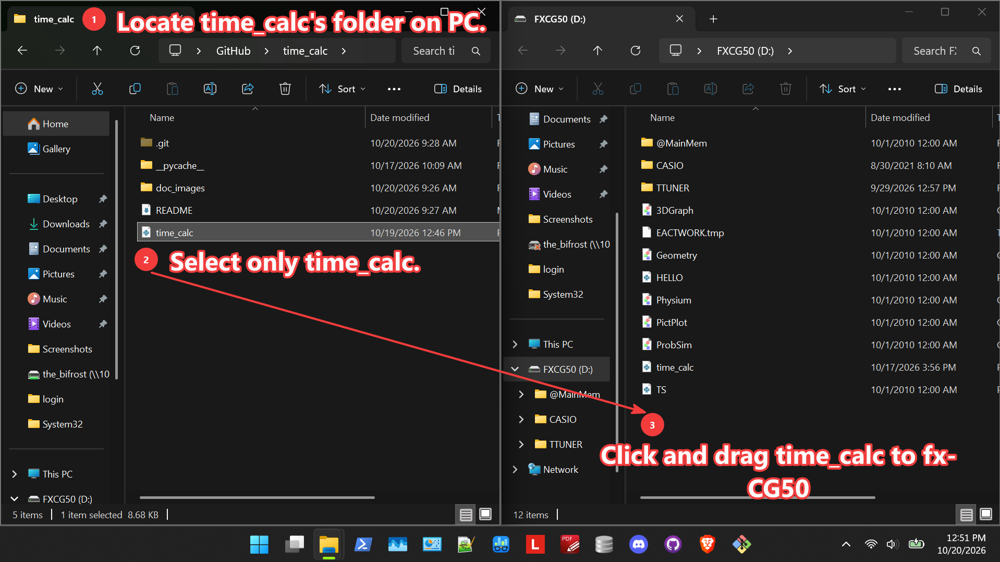
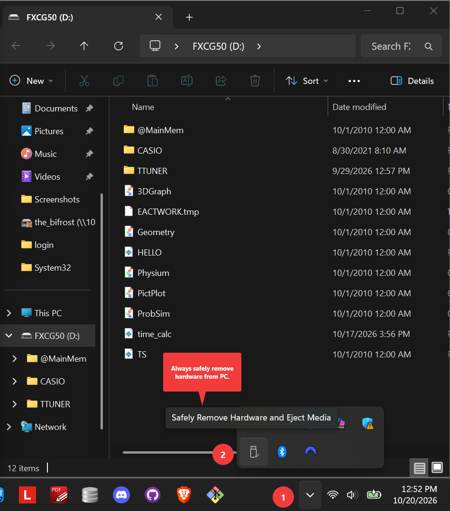
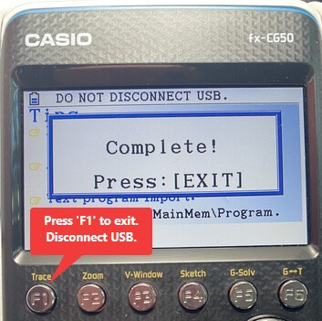
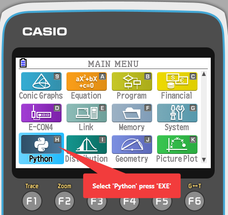
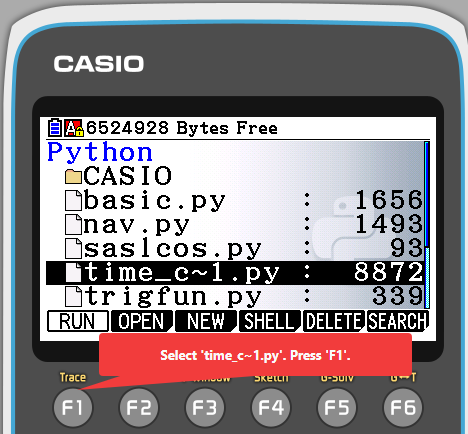
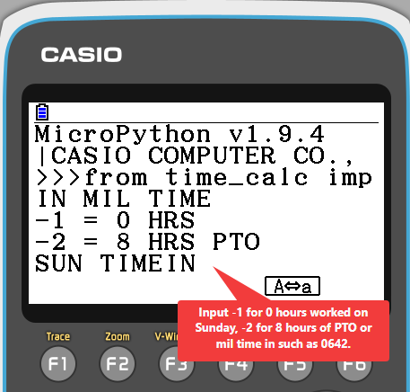
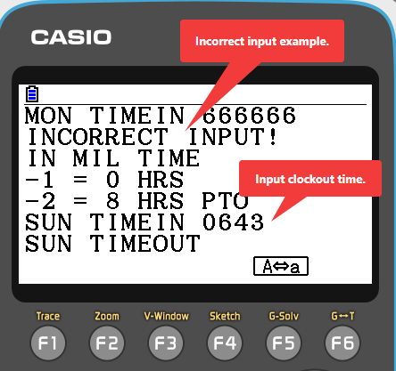
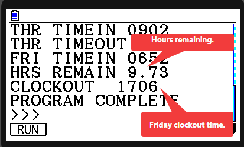
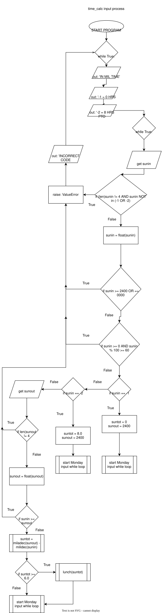

# time_calc.py
| FIELD          | VALUE                |
|:----------------:|:------------------:|
|SOFTWARE NAME  |    time_calc.py                   |
|VERSION        |        Alpha               |
|ENGINEER(S)    |       Zachary Roberts                |
|DATE INITIATED |    16 OCT 2026                 |
|DATE ACCEPTED  | 19 OCT 2026       |
|LANGUAGE(S)    |        MicroPython  1.9.4              |
|TARGET ENVIRONMENT|       Widows machine, Casio fx-CG50 Calculator             |
|DEVELOPMENT STATUS| REQUIREMENTS DESIGN IMPLEMENTATION TESTING (MAINTENANCE)|


## 1. USER DOCUMENTATION

### 1A FUNCTION DESCRIPTION MANUAL

time_calc.py allows the user to calculate remaining hours to be worked on Fridays at a specific organization. It follows business rules at the organization in question such as deducting .50 hours for lunch if greater than or equal to 6 hours have been worked and assumes a 40-hour work week. It does not allow for Saturday inputs or overnight shifts as they are not applicable for this very specific use case.

The user inputs their clockings Sun-Fri, the program prints how many hours must be worked on Friday, and when the user can clock out.

### 1B INSTALLATION MANUAL

1. **Desktop:**
    -  System Reqs:
        - Python 3.13 (tested)
        - Windows 10 or better (tested)
        - 8892 bytes of storage

    - Desktop Installation Process: 
        1. Download latest Python interpreter
        2. Clone Repository at [REPO] (https://github.com/zeerob440/time_calc)

2. **Casio fx-CG50 calculator**
    - System Reqs:
        - MicroPython 1.9.4
        - fx-CG50 Calculator OR fx-CG50 emulator
        - 8892 bytes of storage

    - **Casio fx-CG50 Emulator Installation Process:**
        1. Download fx-CG50 Emulator [EMULATOR] (https://edu.casio.com/intl/software/emulators/product/fxcgm_plus/)
        2. Open fx-CG50 desktop application.
        3. 
        4. 
        5. 
        6. 
        7. 

    - **Casio fx-CG50 Installation Process**
        1. Power on the calculator.
        2. 
        3. 
        4. 
        5. 

        

### 1C INTRODUCTORY MANUAL

Before using the system it is important to understand the scope of the software. time_calc only accepts HHMM military time, -1 for 0 hours, and - 2 for 8 hours of PTO.

The user inputs their clock in and clock out times for each prompted day. After the Friday clock in time is completed, the program prints how many hours remain and when the user's clock out time on Friday is in standard military time such as 1332.

### 1D REFERENCE MANUAL

1. 
2. 
3. 
4. 
5. 


### 1E SYSTEM ADMINISTRATORS MANUAL

NOT APPLICABLE. SYSTEM GOVERNANCE IS DEFINED BY ADMINISTRATOR'S ORGANIZATION BUSINESS RULES.

## 2 SYSTEM DOCUMENTATION

### 2A SYSTEM DEPENDENCIES MANUAL

MicroPython 1.4.9 as implemented on a Casio fx-CG50 calculator is constrained and does not behave like Python on a desktop. For instance:
- Formatted strings are not supported.
- Declarations >= to 8 chars are not supported.
- Viewport is only 22x7 character spaces.

### 2B SYSTEM ARCHITECTURE MANUAL

#### DESCRIPTION

time_calc.py is a single file program that contains three functions. These functions work to take standard military time such as 0445, converts it to decimal 4.75 time whereby this value is used to calculate hours worked. If greater than or equal to 6 hours are worked it subtracts .50 hours for lunch. Lastly, the clock out time on Friday is converted from decimal back to HHMM such as 1630.

**time_calc Input Architecture**




#### DIRECTORY ARCHITECTURE

```text
time_calc/
├── README.md
├── __pycache__
|   ├── test.cpython-313.pyc
|   └── time_calc.cpython-313.pyc
├── time_calc.py
└── doc_images/ # image files for README.md go in this directory.
    ├── em_fr1r.png
    ├── em_mm0r.png
    ├── em_sav5r.png
    ├── em_selfile4r.png
    └── em_2r.png
```

### 2C SYSTEM DECOMPOSITION MANUAL

| PROGRAM       | PURPOSE              | FUNCTIONS                | CLASSES      | LIBRARIES             |
|:-------------|:---------------------|:--------------------------|:------------|:----------------------|
|time_calc.py|Takes HHMM input, returns time of clock out on Friday| decamil(time), miladec(time), lunch(mthirty)| NONE| NONE|

#### UNIT DESCRIPTION MANUAL

|UNIT|FUNCTIONAL DESCRIPTION                                                                                                  |
|:-------------|:-------------------------------------------------------------------------------------------------------------|
|decamil(time)|Expects a float arg as decimal military time, converts it to  an int and returns standard military time|
|miladec(time)| Takes an int as standard military time like 1630 and converts it to decimal military time (16.50) returns decimal military time|
|lunch(mthirty)| Expects a float arg, decrements .50 if float is >= 6.0 returns decremented value.|

### 2D REQUIREMENTS SPECIFICATION & TEST MANUAL

|REQUIREMENT SPECIFICATION|TEST NAME|TEST SPECIFICATION                         |FUNCTIONS AS DESIGNED DATE|
|:------------------------|:--------|:------------------------------------------|:-------------------------|
|The system accepts military time (2242).| T1 MILTIME IN| Test all inputs for miltime with invalid entries.| 19 OCT 2026|
|The system must account for PTO and 0 hours worked| T2| -1, -2 sentinels tested in all input states| 19 OCT 2026|
|The system must deduct .50 hours of time worked for any shift >= 6 hrs| T3 NO FREE LUNCH| lunch(mthirty) tested on all input prompts| 19 OCT 2026|
|The system must return Friday clockout as HHMM (1642)| T4 MILTIME OUT| tested on several output cases| 19 OCT 2026 |
