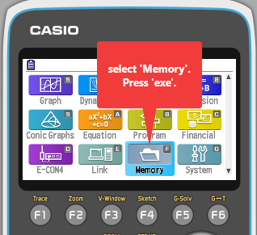
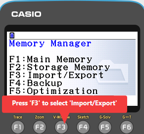
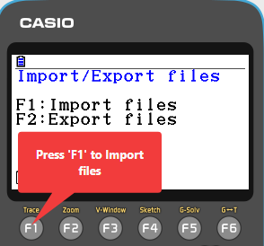
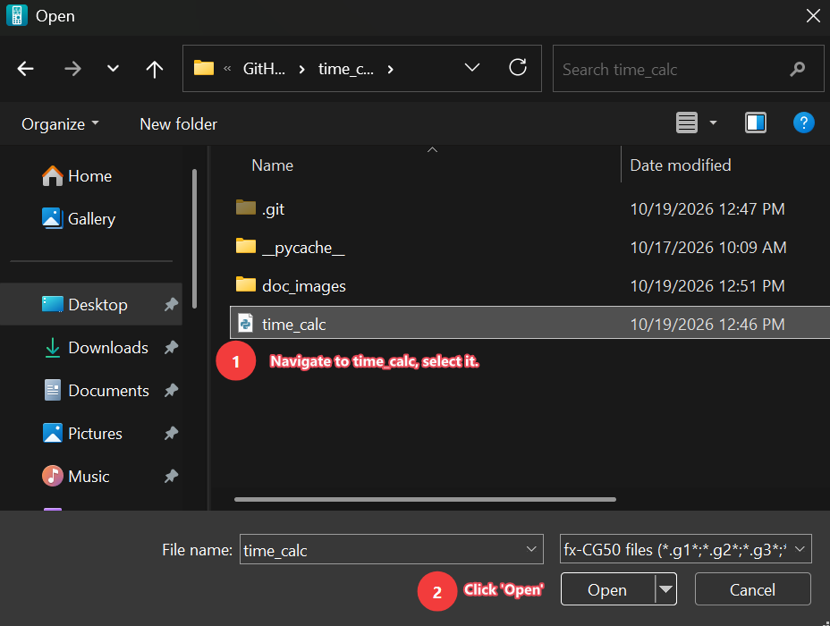
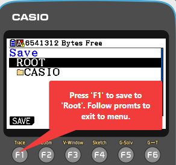

# time_calc.py
| FIELD          | VALUE                |
|:----------------:|:------------------:|
|SOFTWARE NAME  |    time_calc.py                   |
|VERSION        |        Alpha               |
|ENGINEER(S)    |       Zachary Roberts                |
|DATE INITIATED |    16 OCT 2026                 |
|DATE ACCEPTED  | 19 OCT 2026       |
|LANGUAGE(S)    |        MicroPython  1.94              |
|TARGET ENVIRONMENT|       Widows machine, Casio fx-CG50 Calculator             |
|DEVELOPMENT STATUS| REQUIREMENTS DESIGN IMPLEMENTATION TESTING (MAINTENANCE)|


## 1. USER DOCUMENTATION

### 1A FUNCTION DESCRIPTION MANUAL

time_calc.py allows the user to calculate remaining hours to be worked on Fridays at a specific organization. It follows business rules at the organization in question such as deducting .50 hours for lunch if greater than or equal to 6 hours have been worked and assumes a 40-hour work week. It does not allow for Saturday inputs or overnight shifts as they are not applicable for this very specific use case. 

### 1B INSTALLATION MANUAL

1. Desktop:
    -  System Reqs:
        - Python 3.13 (tested)
        - Windows 10 or better (tested)
        - 8892 bytes of storage

    - Desktop Installation Process: 
        1. Download latest Python interpreter
        2. Clone Repository at [REPO] (https://github.com/zeerob440/standard_documentation)

2. Casio fx-CG50 calculator
    - System Reqs:
        - MicroPython 1.9.4
        - fx-CG50 Calculator OR fx-CG50 emulator
        - 8892 bytes of storage

    - Casio fx-CG50 Emulator Installation Process:
        1. Download fx-CG50 Emulator [EMULATOR] (https://edu.casio.com/intl/software/emulators/product/fxcgm_plus/)
        2. Open fx-CG50 desktop application.
        3. 
        4. 
        5. 
        6. 
        7. 

    - Casio fx-CG50 Installation Process
        1. Power on the calculator.
        2. FIXME: add screen shots for fxcg50 installation process.

### 1C INTRODUCTORY MANUAL

- EXPLAIN HOW TO USE SYSTEM IN SIMPLE TERMS
- USE ANNOTATED SCREEN SHOTS

### 1D REFERENCE MANUAL
- DESCRIBE ALL SYSTEM FACULTIES TO USER AND HOW TO USE THEM


### 1E SYSTEM ADMINISTRATORS MANUAL

- DESCRIBE SYSTEM HOUSEKEEPING TASKS
- DESCRIBE SYSTEM MAINTENANCE PROCEDURES
- IF ADMIN NOT REQUIRED
NOT APPLICABLE. SYSTEM GOVERNANCE IS DEFINED BY ADMINISTRATOR'S ORGANIZATION BUSINESS RULES.

## 2 SYSTEM DOCUMENTATION

### 2A SYSTEM DEPENDENCIES MANUAL
 - LIST DEPENDENCIES 

### 2B SYSTEM ARCHITECTURE MANUAL

#### DESCRIPTION
Plain text description here.

#### DIRECTORY ARCHITECTURE

```text
time_calc/
├── README.md
├── time_calc.py
└── doc_images/
    ├── em_fr1r.png
    ├── em_mm0r.png
    ├── em_sav5r.png
    ├── em_selfile4r.png
    └── em_2r.png
```

### 2C SYSTEM DECOMPOSITION MANUAL

| PROGRAM       | PURPOSE              | FUNCTIONS                | CLASSES      | LIBRARIES             |
|:-------------|:---------------------|:--------------------------|:------------|:----------------------|
|example.py|Provides examples for documentation.| examples(num), lookup()| Examples, Nav| hashlib, math|

#### UNIT DESCRIPTION MANUAL

|UNIT|FUNCTIONAL DESCRIPTION                                                                                                  |
|:-------------|:-------------------------------------------------------------------------------------------------------------|
|example(num)|example(num) takes and integer argument and returns an example.|

### 2D REQUIREMENTS SPECIFICATION & TEST MANUAL

|REQUIREMENT SPECIFICATION|TEST NAME|TEST SPECIFICATION                         |FUNCTIONS AS DESIGNED DATE|
|:------------------------|:--------|:------------------------------------------|:-------------------------|
|The system only accepts military time.| T1 MILTIME| Test all inputs for miltime with invalid entries.| 26 APR 1979|
